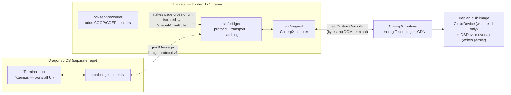

# Dragon86 Hoster (CheerpX-Bridge)

The **headless CheerpX engine page** for [Dragon86](https://github.com/Dragon-Gaming-Platforms/Dragon86),
a web OS by Dragon Gaming Platforms. This repo has **no product UI**: it boots a
Linux shell (bash on Debian) inside [CheerpX](https://cheerpx.io) and exposes
it to the OS through a small `postMessage` bridge. Dragon86 embeds this page in
a hidden 1×1 iframe and renders the terminal itself.

## Architecture



Boot sequence:

1. The OS creates a hidden iframe pointing at this page and starts sending
   `{v:1, t:"hello"}` every ~400 ms.
2. On the **first-ever visit**, `coi-serviceworker` installs and reloads the
   page once so its responses carry `Cross-Origin-Opener-Policy: same-origin`
   and `Cross-Origin-Embedder-Policy: require-corp` (GitHub Pages cannot set
   headers itself). The page is now cross-origin isolated, which unlocks
   `SharedArrayBuffer` — a hard requirement for CheerpX. The worker lives at
   this site's root, so its scope is exactly this project site; it can never
   control the OS site or any other page.
3. The page loads the CheerpX runtime **from Leaning Technologies' CDN**
   (never bundled or self-hosted), mounts the disk image with a persistent
   IndexedDB overlay, wires I/O through `cx.setCustomConsole`, and runs
   `/bin/bash --login`.
4. Only once bash is actually booted and streaming does the hoster answer
   `hello` with `{v:1, t:"ready"}`. It then replays the buffered first prompt
   and streams I/O both ways until the shell exits.

## Bridge protocol v1

Plain objects over `postMessage`, every message carries `v: 1`. This must
stay behavior-identical to `src/bridge/hoster.ts` in the OS repo.

| Direction    | Message                             | Meaning                                                   |
| ------------ | ----------------------------------- | --------------------------------------------------------- |
| OS → hoster  | `{v:1, t:"hello"}`                  | Handshake probe, repeated ~400 ms until answered         |
| hoster → OS  | `{v:1, t:"ready"}`                  | Cross-origin isolated **and** bash booted and streaming   |
| OS → hoster  | `{v:1, t:"data", d:string}`         | Keystrokes → PTY stdin (UTF-8)                            |
| hoster → OS  | `{v:1, t:"data", d:string}`         | PTY stdout → terminal, coalesced on a ~16 ms cadence      |
| OS → hoster  | `{v:1, t:"resize", cols, rows}`     | Terminal size → PTY winsize (vim/top redraw)              |
| hoster → OS  | `{v:1, t:"exit", code}`             | Shell exited with this code                               |

Rules and guarantees:

- **Ready means ready.** `ready` is sent only after the shell has started and
  produced output. If the engine fails to boot, the hoster stays silent and
  the OS times out at 6 s showing "not connected" — by design.
- **Batched output.** Engine output is buffered and flushed as one `data`
  message per ~16 ms window (never one message per byte), decoded with a
  streaming UTF-8 decoder. Output produced before the handshake (the first
  prompt) is buffered and replayed right after `ready`.
- **Origin allowlist.** Inbound messages are accepted only from the direct
  parent frame and only from: this site's own origin (in production the OS is
  the _same_ origin — `dragon-gaming-platforms.github.io` hosts both project
  sites), `https://dragon-gaming-platforms.github.io` explicitly, Arena agent
  preview origins (`https://<port>-<id>.e2b.app`, for embedded testing), and
  `http://localhost:*` / `http://127.0.0.1:*` for development. Replies are
  addressed to the exact origin that said hello — never `"*"`. A hello
  rejected for its origin logs **one** console warning per origin (naming the
  offending origin) so a misconfigured embed is diagnosable instead of
  silently timing out — the wire protocol itself stays silent toward
  untrusted origins.
- **Resize reaches the TTY** (re-attaching the CheerpX console at the new
  size, which is how CheerpX exposes winsize changes), so full-screen apps
  redraw when the OS window is resized.
- New fields may be added within v1 only if backward compatible.

The protocol/transport/batching layer (`src/bridge/`) is **engine-free**; the
only file that knows about CheerpX is `src/engine/cheerpxEngine.ts`. If the
CheerpX API changes, only that adapter changes. Protocol behavior is covered
by regression tests (`npm test`, runs in Node).

## Getting the URL for Dragon86 → Settings → Engine

After the first successful deploy (push to `main`; see
`.github/workflows/deploy.yml`):

1. One-time setup: repo **Settings → Pages → Build and deployment → Source:
   GitHub Actions**.
2. Find the live URL in repo **Settings → Pages** ("Your site is live at …"),
   or in the **Actions** tab → latest _Deploy to GitHub Pages_ run → the
   `deploy` job's environment URL.
3. The URL is `https://dragon-gaming-platforms.github.io/<repo-name>/`.
   This repo is currently named **CheerpX-Bridge**, so the URL is
   `https://dragon-gaming-platforms.github.io/CheerpX-Bridge/`. If you rename
   the repo to `dragon86-hoster`, it becomes
   `https://dragon-gaming-platforms.github.io/dragon86-hoster/` — the site
   uses relative paths throughout, so it works under either name.
4. Open the URL once in a browser: the status page should show
   _Cross-origin isolated: yes_, _SharedArrayBuffer: available_, _Engine:
   running_. (First-ever load reloads itself once while the service worker
   installs.)
5. Paste the full URL (including the trailing `/`) into **Dragon86 →
   Settings → Engine**.

## Pages in this repo

| Page             | Purpose                                                                                                  |
| ---------------- | -------------------------------------------------------------------------------------------------------- |
| `index.html`     | The engine page. Boots CheerpX + bash, serves the bridge, shows a tiny status line for humans.            |
| `debug.html`     | Rough same-page harness: raw textarea "console" + protocol log speaking v1 over a loopback transport. Test without the OS. |
| `embed-test.html`| Fake-OS harness: embeds `index.html` as a hidden iframe and drives it over real `postMessage`, mirroring the OS bridge (400 ms hello, 6 s timeout). |
| `coi-serviceworker.js` | Vendored [coi-serviceworker](https://github.com/gzuidhof/coi-serviceworker) v0.1.7 (MIT), forces `require-corp` mode via `window.coi = { coepCredentialless: () => false }` for Safari. |

## Configuration

Everything tunable is in [`src/config.ts`](src/config.ts):

- **`CHEERPX_RUNTIME_URL`** — the single constant for the proprietary runtime
  (`https://cxrtnc.leaningtech.com/1.2.8/cx.esm.js`). Loaded from the CDN
  only; never vendored. Bumping the version is a one-line change.
- **`DISK`** — root filesystem source. Default: the hosted Debian image from
  the official CheerpX quickstart via `CloudDevice`, with an `IDBDevice`
  overlay so writes persist across reloads. To use a custom image later:
  build an ext2 following CheerpX's _Custom disk images_ guide, drop it in
  `public/`, and set `kind: "http-bytes", url: "./image.ext2"` (uses
  `HttpBytesDevice`; mind GitHub Pages artifact size limits for big images).
- **`IDB_OVERLAY_NAME`** — namespaced on purpose: all project sites under
  `dragon-gaming-platforms.github.io` share one origin and one IndexedDB.
- **`ALLOWED_PARENT_ORIGINS` / `ALLOWED_PARENT_ORIGIN_PATTERNS`** — exact
  origins (add the OS origin here if it ever moves to a custom domain) and
  regex patterns for generated origins (currently Arena agent previews,
  `^https://\d+-[a-z0-9-]+\.e2b\.app$`).

## Local development

```sh
npm install
npm run dev      # Vite dev server (sets COOP/COEP itself, so no SW wait)
npm run build    # typecheck + production build to dist/
npm run preview  # serve the production build locally
npm test         # bridge protocol regression tests (Node)
```

To test against a local Dragon86 checkout, point the OS's engine URL at the
Vite URL (e.g. `http://localhost:5173/`). Localhost parents are allowlisted —
but see the cross-origin caveat in [OS integration](#os-integration).

## Manual test checklist

1. Open `debug.html`: status shows _cross-origin isolated: yes_,
   _SharedArrayBuffer: available_; the bash prompt appears in the textarea;
   `echo hi` round-trips.
2. In the debug console: `touch ~/persist-test`, reload the page, `ls ~` —
   the file is still there (IDB overlay).
3. `stty size`, then **Send resize** with new cols/rows, `stty size` again —
   the PTY size changed. `top` / `vim` spew escape sequences (that's the raw
   console working as intended) and redraw on resize.
4. `exit` in the debug console — the protocol log shows `{v:1,t:"exit",code:0}`.
5. Open `embed-test.html`: the handshake completes (_READY ✓_ with timing),
   **Send "echo hi"** round-trips through the hidden iframe, resize and exit
   behave. Note the parent page itself is _not_ cross-origin isolated — only
   the iframe needs to be.
6. Point a real Dragon86 build at the deployed URL (Settings → Engine) and
   open its terminal.

## OS integration

### Cross-origin embedding and cross-origin isolation

CheerpX needs `SharedArrayBuffer`, which requires this page to be
**cross-origin isolated inside the iframe**. The hoster does everything
required of the child (COOP/COEP plus `Cross-Origin-Resource-Policy:
cross-origin`, added by its service worker) — but whether isolation is
*granted* also depends on the parent. The rules, verified against
[web.dev's cross-origin isolation guide](https://web.dev/articles/cross-origin-isolation-guide)
and MDN:

| Parent setup                                                                                              | Hoster isolated? |
| --------------------------------------------------------------------------------------------------------- | ---------------- |
| **Same origin** as the hoster (production today: both sites on `dragon-gaming-platforms.github.io`)        | ✅ Yes — the hoster isolates itself; the parent needs nothing, not even the `allow` attribute. |
| **Cross-origin**, parent page **is itself cross-origin isolated**, iframe has `allow="cross-origin-isolated"` (Dragon86 already sets this attribute) | ✅ Yes — the isolated parent delegates the capability to the iframe. |
| **Cross-origin**, parent page is **not** cross-origin isolated                                             | ❌ **No — this cannot work.** `allow="cross-origin-isolated"` does **not** help on its own: a parent cannot grant isolation it doesn't have. The whole frame chain must be cross-origin isolated. |

**To be explicit: from a non-COI cross-origin parent, this page cannot become
cross-origin isolated, `SharedArrayBuffer` stays unavailable, CheerpX cannot
boot, and the hoster never answers `hello` — the OS just times out.** There is
no workaround from inside the iframe. A cross-origin parent that wants the
engine must do **both** of these itself:

1. **Become cross-origin isolated**: serve the OS page with
   `Cross-Origin-Opener-Policy: same-origin` and
   `Cross-Origin-Embedder-Policy: require-corp` (or `credentialless`) — as
   real headers from its server, or via its own copy of coi-serviceworker if
   it also can't set headers — and
2. **Delegate to the iframe**: `<iframe allow="cross-origin-isolated" …>`
   (already set by Dragon86; enforced by Chromium browsers — Firefox/Safari
   don't implement that Permissions-Policy directive but enforce the same
   frame-chain requirement through COOP/COEP, so keep the attribute anyway).

Plus the message-layer requirement: the parent origin must be on this
hoster's allowlist (`ALLOWED_PARENT_ORIGINS` /
`ALLOWED_PARENT_ORIGIN_PATTERNS` in `src/config.ts`).

Practical consequences:

- **Testing from generated preview origins** (Arena `*.e2b.app` previews are
  allowlisted for messages): if the OS preview is served *without*
  COOP/COEP, the handshake still won't complete — not because of the
  allowlist, but because the engine can't boot. Serve the OS preview with
  isolation headers (e.g. Vite `server.headers`, like this repo's
  `vite.config.ts`) so the parent is COI, and the cross-origin combination
  above applies. If the preview serves OS and hoster from the *same*
  origin, it's the same-origin row and just works.
- **Dev on different localhost ports** is cross-origin too (port differs),
  so the same rule applies — `debug.html` and `embed-test.html` are the
  reliable local harnesses.
- **If Dragon86 moves to a custom domain**, the OS page must take on
  requirement 1 (it already does 2), and its origin must be added to this
  hoster's allowlist.

### Cold-boot timing

- **Cold first boot can exceed the OS's 6 s timeout.** On a visitor's very
  first load, the service-worker install + one reload + WASM compile + disk
  connect can take longer than 6 s; the OS will show "not connected" even
  though the engine comes up moments later. A retry (or any later terminal
  open) is warm and fast. Consider resetting the 6 s budget when the iframe
  reloads (`load` fires again after the SW reload), or a longer first-visit
  budget — details in `src/main.ts`/`hoster.ts` comments.

## Troubleshooting

- **Engine never connects from an embedded OS** — open devtools on the
  *hoster* frame: if the parent's origin isn't allowlisted you'll see one
  `[dragon86-hoster] Ignoring bridge hello from non-allowlisted parent
  origin "…"` warning naming the exact origin to add. If there's no warning
  but also no `ready`, check `crossOriginIsolated` in the hoster frame —
  from a cross-origin parent it can only be `true` if the parent itself is
  cross-origin isolated (see [OS integration](#os-integration)).
- **`crossOriginIsolated: no` on the status page** — the service worker isn't
  controlling the page yet (hard-reload), the context isn't secure (needs
  HTTPS or localhost), or service workers are unavailable (some private-mode
  setups). Without it there is no `SharedArrayBuffer` and the engine cannot
  start; the page explains this instead of failing obscurely.
- **Engine fails, status shows FAILED** — usually the CheerpX CDN or disk
  websocket unreachable. The error detail is shown on the status page and in
  the console; the OS simply times out.
- **Files don't persist** — IndexedDB unavailable/blocked, or
  `IDB_OVERLAY_NAME` changed (that intentionally starts a fresh overlay).

## Repository layout

```
index.html               engine page (status line + boot)
debug.html               same-page raw console harness
embed-test.html          fake-OS iframe harness
public/
  coi-serviceworker.js   vendored COOP/COEP service worker (MIT)
src/
  config.ts              every tunable (runtime URL, disk, allowlist…)
  bridge/
    protocol.ts          message types, validation, origin allowlist
    hosterBridge.ts      ready-gating, batching, postMessage/loopback transports
  engine/
    adapter.ts           engine contract (bridge-facing interface)
    cheerpx.d.ts         minimal typings for the CDN runtime
    cheerpxEngine.ts     the ONLY CheerpX-specific code
  hoster.ts              wiring: transport + engine + isolation gate
  status.ts              human-visible status line
  main.ts / debug.ts / embedTest.ts   page entry points
test/bridge.test.ts      protocol regression tests (npm test)
third-party/             third-party license texts
.github/workflows/deploy.yml   build + deploy to GitHub Pages on push to main
```

No login, no analytics, no tracking. The only network calls are to Leaning
Technologies' CDN (CheerpX runtime), the disk-image websocket
(`wss://disks.webvm.io`), and this site's own static files.

## License

- **This repository's code** is licensed under the GNU Affero General Public
  License v3.0 — see [`LICENSE`](LICENSE).
- **CheerpX runtime**: proprietary software of Leaning Technologies, loaded
  at runtime from their CDN (`cxrtnc.leaningtech.com`) under the CheerpX
  Community License. It is **not** included in, or distributed by, this
  repository. See [cheerpx.io](https://cheerpx.io/docs) for their terms. The
  default disk image is Leaning Technologies' hosted Debian image (Debian
  itself is free software) streamed from their infrastructure, likewise not
  distributed here.
- **coi-serviceworker**: MIT, © Guido Zuidhof and contributors. Vendored at
  [`public/coi-serviceworker.js`](public/coi-serviceworker.js) with its
  license text preserved in
  [`third-party/coi-serviceworker.LICENSE`](third-party/coi-serviceworker.LICENSE).
